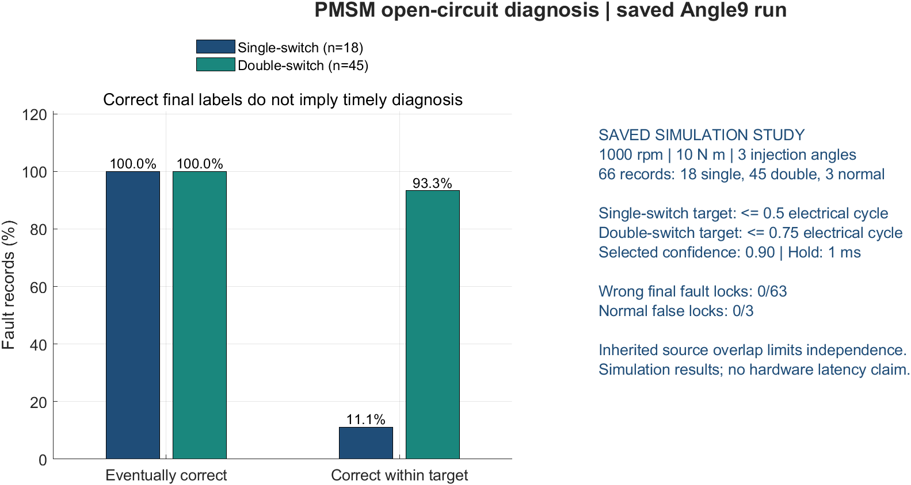
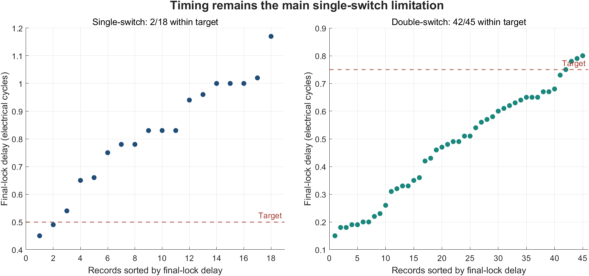

# PMSM Drive Fault Diagnosis

**Current-based diagnosis of inverter open-circuit faults and exploratory current-sensor gain faults.**

Shubo Zhang · Tiangong University · Ongoing undergraduate research  
Public research snapshot: 4 November 2026

This project investigates how three-phase current measurements can identify **6 single-switch and 15 double-switch open-circuit configurations** in a permanent-magnet synchronous motor (PMSM) drive. My work includes modeling, simulation, data processing, feature extraction, diagnostic algorithms, and evaluation of decision timing.

The engineering question is whether a diagnosis is **correct, sufficiently early, and robust to sensor errors**. The current study illustrates a tradeoff: a stricter confidence threshold eliminated wrong final fault locks in one saved run, while most single-switch cases still missed the half-cycle timing target.



## Start here

- [One-page research summary](docs/research-summary.pdf)
- [Methods, assumptions, and limitations](docs/METHODS.md)
- [Reproduce the published CSV statistics](#reproduce-the-saved-results)
- [Original MATLAB feature extraction](matlab/code/pmsm_angle_features.m)
- [Original causal decision-lock implementation](matlab/code/gt_fast_lock_1ms.m)
- [Simulink model](models/PMSM.slx)

## Diagnostic pipeline


The sensor prototype is documented separately. It is not a validated final joint open-circuit/sensor diagnosis system.

## Saved open-circuit results

**Scope:** 66 saved simulation records at **1000 rpm, 10 N·m**, with fault-injection angles **90°, 210°, and 330°**: 18 single-switch, 45 double-switch, and 3 normal records. These are repeat records of the 21 fault configurations, not 63 distinct fault types.

The Angle9 model uses a **0.90 confidence threshold selected on validation**, followed by **1 ms of continuous agreement above threshold**. The 1 ms setting is a decision-confirmation interval, not measured CPU execution time or a guaranteed total diagnostic delay.

| Measure | Saved-run result |
|---|---:|
| Single-switch correct decisions within 0.5 electrical cycle | 2/18 (11.1%) |
| Double-switch correct decisions within 0.75 electrical cycle | 42/45 (93.3%) |
| Median lock delay, single-switch | 12.803 ms |
| Median lock delay, double-switch | 7.614 ms |
| Wrong final fault locks | 0/63 |
| Normal false locks | 0/3 |

All 63 fault records eventually locked to the correct class. **This is not a claim of 100% general accuracy:** the single-switch timing target remains unmet in most records, the operating-condition coverage is narrow, and a normal-current source group crosses the train/validation/test roles in the inherited split. See [source-overlap evidence](evidence/cross_role_source_groups.csv).



## A comparison that did not solve the problem

I also evaluated fixed healthy-amplitude normalization with shorter 0.25/0.5-cycle half-wave features (AngleAmpHalf). On the same saved test subset, its validation-selected threshold produced **0/18** timely single-switch decisions, **24/45** timely double-switch decisions, and **1/63** wrong final fault locks. It did not improve this baseline. The comparison changes both normalization and window length, so it cannot isolate their individual effects.

The original Angle9 threshold produced 26/63 wrong fault locks and 9/18 timely single-switch decisions; the validation-selected 0.90 rule produced 0/63 and 2/18, respectively. This is an observed accuracy/timing tradeoff, not a successful single-switch speed-up.

## Sensor gain drift: separate exploratory evidence

A separate prototype was replayed on **108 correlated synthetic perturbation cases derived from only 3 normal parent records**. The cases span 3 affected phases, 6 gain factors (0.70, 0.80, 0.925, 1.075, 1.20, 1.30), and 2 stored ramp settings. It recorded 108/108 correct locks, with median lock delay **9.073 ms**, and no wrong or open-switch false locks in these cases.

These are not 108 independent experiments. The prototype uses raw-current consistency statistics and assumes suitable independent phase measurements; it is not evidence that pointwise-L2 features alone resolve gain drift. Common gain changes, reconstructed sensor channels, simultaneous sensor/open-switch faults, and hardware deployment require further study.

## Reproduce the saved results

No training dataset or proprietary toolbox is required to recompute the record-level statistics:

```bash
cd projects/pmsm-fault-diagnosis
python scripts/reproduce_results.py
```

The script reads the original exported CSVs, checks their summaries and parent counts, and prints the results. It does not train a classifier or run the Simulink model.

To regenerate the plots and check the MATLAB decision-lock function in MATLAB R2024a:

```matlab
cd('path/to/shubo/projects/pmsm-fault-diagnosis')
RUN_PORTFOLIO_DEMO
```

The MATLAB demo uses saved CSV outputs, runs focused lock-logic checks, and exports the two figures above. Full feature extraction/training requires additional raw recordings, frozen model files, and the toolboxes described in [reproduction notes](docs/REPRODUCTION.md). The supplied model is a source model, not a packaged standalone simulation experiment.

## Repository contents

```text
matlab/code/             Original feature, training, scoring, and lock functions
matlab/sensor_prototype/ Selected original exploratory sensor routines
matlab/RUN_*.m           Original experiment entry points; external inputs required
models/PMSM.slx          Supplied Simulink source model
evidence/               Original CSV exports and a SHA-256 source manifest
scripts/                CSV-only statistics reproduction
assets/                 Model preview and figures generated from saved CSVs
docs/                   Research summary and technical/reproduction notes
RUN_PORTFOLIO_DEMO.m    CSV visualization and focused MATLAB checks
```

## Next research steps

1. Improve early discrimination between single- and double-switch faults.
2. Establish source-disjoint evaluation across additional speeds, loads, and injection angles.
3. Evaluate single-phase sensor gain drift under noise, offsets, and realistic sensor topology.
4. Validate joint diagnoses and measure inference latency on the intended deployment hardware.

The source is shared as a research portfolio snapshot. No additional open-source license is granted in this snapshot.
